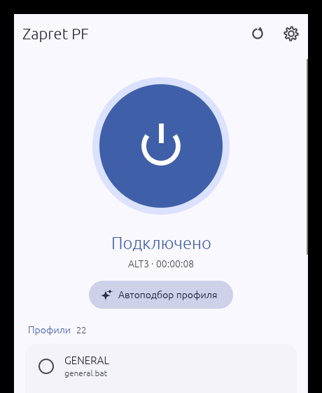
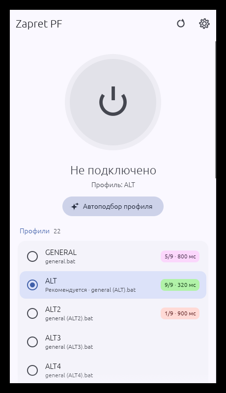
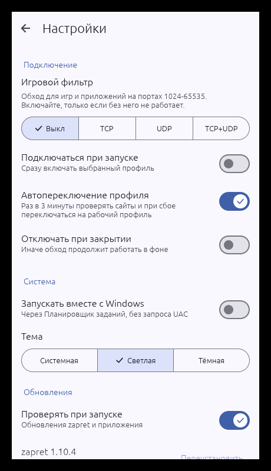
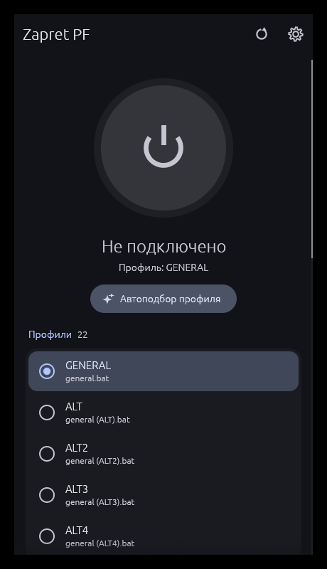

<div align="center">


# Zapret PF

**Простой клиент в стиле Material Design 3 для [zapret-discord-youtube](https://github.com/Flowseal/zapret-discord-youtube)**<br>
Одна кнопка подключения, список профилей, автоподбор рабочей стратегии и обновления в один клик.

[](https://github.com/zaxar1231/zapret-pf/actions/workflows/build.yml)
[](https://github.com/zaxar1231/zapret-pf/releases/latest)


[](LICENSE)

 &nbsp;
 &nbsp;


</div>

## Возможности

- **Одна кнопка, как у VPN.** Нажали — обход включён, нажали ещё раз — выключен. Таймер подключения и активный профиль видны сразу.
- **Все профили в одном списке.** Приложение читает `general*.bat` из zapret и запускает `winws.exe` с теми же аргументами, только без консольных окон.
- **Автоподбор профиля.** Профили запускаются по очереди, на каждом проверяются Discord, YouTube, Google и Cloudflare. Лучший профиль выбирается и включается автоматически. Рядом с каждым профилем видно, сколько проверок он прошёл и за сколько миллисекунд.
- **Автопереключение профиля.** Пока подключение активно, приложение раз в 3 минуты проверяет, открываются ли сайты. Если профиль дважды подряд не прошёл проверку, а интернет при этом есть, приложение само ищет рабочий профиль: сначала среди тех, что раньше показывали лучшие результаты. Если `winws.exe` неожиданно завершился, он перезапускается. Проверки работают и тогда, когда окно свёрнуто в трей. Отключить их можно в настройках.
- **Иконка в трее.** Крестик сворачивает окно в трей, обход и автопереключение продолжают работать. По иконке видно статус (синяя — подключено, серая — нет). В меню иконки можно подключиться, отключиться, открыть окно или выйти. При автозапуске с Windows приложение сразу стартует в трее.
- **Обновления zapret.** При запуске приложение сверяет версию с `version.txt` в flowseal/zapret-discord-youtube. Если вышла новая, появляется карточка «Обновить». Пользовательские списки (`*-user.txt`) при обновлении сохраняются.
- **Автообновление приложения.** Новые версии Zapret PF ищутся в GitHub Releases. По кнопке «Установить» установщик ставит обновление в тихом режиме и снова запускает приложение.
- **Всё хранится в папке установки.** Профили и файлы zapret лежат в `C:\Program Files\ZapretPF\zapret`, а не на рабочем столе.
- **Установщик** с ярлыком в меню «Пуск», необязательным ярлыком на рабочем столе, исключением в Защитнике Windows (по желанию) и корректным удалением, которое убирает службы и драйвер WinDivert.
- **Настройки:** игровой фильтр (TCP / UDP / TCP+UDP), запуск вместе с Windows без запроса UAC, подключение при запуске, светлая, тёмная или системная тема, обновление списка IPSet.
- **Тёмная тема и MD3:** тональная палитра, скругления, Switch и Segmented button, snackbar-уведомления.

<div align="center">
 &nbsp;

</div>

## Установка

1. Скачайте `ZapretPF-Setup-x.y.z.exe` со страницы [Releases](https://github.com/zaxar1231/zapret-pf/releases/latest).
2. Запустите установщик. Права администратора нужны, потому что драйвер WinDivert работает только с ними.
3. Откройте **Zapret PF** и нажмите **«Автоподбор профиля»** или просто большую кнопку.

Есть и портативная версия `ZapretPF-x.y.z-portable.zip`: распакуйте её в любую папку **без кириллицы** в пути и запустите `ZapretPF.exe`.

> [!WARNING]
> Microsoft Defender и другие антивирусы иногда считают `winws.exe` или `WinDivert64.sys` потенциально нежелательными (HackTool) и удаляют их. Такая реакция обычна для любых DPI-инструментов. Отметьте при установке пункт «Исключение в Защитнике Windows» или добавьте папку `…\ZapretPF\zapret` в исключения вручную.

## Как это работает

```
C:\Program Files\ZapretPF\
├── ZapretPF.exe            ← приложение (Rust + egui)
├── Uninstall.exe
├── zapret\                 ← файлы flowseal/zapret-discord-youtube
│   ├── general.bat, general (ALT).bat, …   ← профили (стратегии)
│   ├── bin\winws.exe, WinDivert64.sys, *.bin
│   └── lists\list-general.txt, list-general-user.txt, …
└── data\
    ├── config.json         ← настройки и результаты проверки профилей
    └── winws.log           ← вывод winws.exe (для диагностики)
```

1. **Профили.** Каждый `general*.bat` в zapret запускает `bin\winws.exe` с длинной строкой аргументов. Zapret PF склеивает строки, перенесённые через `^`, разбирает аргументы по правилам `cmd.exe`, подставляет `%BIN%`, `%LISTS%`, `%GameFilterTCP%` и `%GameFilterUDP%` и запускает `winws.exe` напрямую в скрытом режиме ([`src/profiles.rs`](src/profiles.rs)).
2. **Подключение** работает так же, как в `service.bat`: включаются TCP timestamps, создаются пользовательские списки, проверяется, не установлена ли конфликтующая служба `zapret`. `winws.exe` продолжает работать и после закрытия окна. При следующем запуске приложение увидит, что подключение активно.
3. **Автоподбор** повторяет идею `utils\test zapret.ps1`. Для каждого профиля запускается `winws.exe`, затем параллельно выполняются HTTPS-запросы к адресам из `utils\targets.txt`. Читается до 64 КБ ответа, чтобы поймать и блокировку «зависанием после 16 КБ». Выигрывает профиль с наибольшим числом успешных проверок, при равенстве — самый быстрый ([`src/tester.rs`](src/tester.rs)).
4. **Обновление zapret.** Приложение скачивает zip последнего релиза, а если его нет, архив ветки `main`. Затем распаковывает его, останавливает `winws.exe` и WinDivert, заменяет папку `zapret` (при ошибке возвращает старую), возвращает пользовательские списки и переподключается ([`src/updater.rs`](src/updater.rs)).
5. **Обновление приложения.** Последний релиз этого репозитория проверяется через GitHub API. Затем скачивается `ZapretPF-Setup-*.exe` и запускается с ключами `/S /UPDATE`.

### Свои сайты

Добавьте домены в `zapret\lists\list-general-user.txt`, исключения — в `list-exclude-user.txt`. Папку открывает кнопка **Настройки → Инструменты → Списки**. Эти файлы не перезаписываются при обновлении.

## Решение проблем

| Симптом | Что сделать |
|---|---|
| «Найдена служба zapret» | Нажмите «Удалить» в карточке. Служба из `service.bat` конфликтует с приложением. |
| Ни один профиль не работает | Обновите zapret, включите игровой фильтр, обновите список IPSet и отключите другие обходы, VPN и прокси. |
| `winws.exe завершился` | Откройте **Журнал winws** в настройках. Чаще всего файл удалил антивирус: переустановите zapret кнопкой «Переустановить». |
| Окно не открывается в виртуальной машине | Приложение пробует DirectX 12/Vulkan, затем OpenGL. Обновите видеодрайвер. |

## Сборка из исходников

Нужен актуальный stable Rust (rustup).

**Windows (MSVC):**

```powershell
cargo build --release
# target\release\ZapretPF.exe — положите рядом папку zapret из flowseal/zapret-discord-youtube
```

**Кросс-сборка exe и установщика из Linux** (так же собирает CI):

```bash
sudo apt install gcc-mingw-w64-x86-64 nsis zip
rustup target add x86_64-pc-windows-gnu
./scripts/build.sh
# dist/ZapretPF.exe, dist/ZapretPF-Setup-x.y.z.exe, dist/ZapretPF-x.y.z-portable.zip
```

Тесты: `cargo test`. Офлайн-тест установки zapret из локального клона: `ZAPRET_SRC=/путь/к/zapret-discord-youtube cargo test install_from_local_zip -- --ignored`.

### Выпуск новой версии

1. Поднимите `version` в `Cargo.toml` (и при желании в `assets/app.rc`).
2. Создайте и отправьте тег `git tag v1.0.1 && git push origin v1.0.1` или запустите workflow **Build** вручную (Actions → Build → Run workflow) с галочкой «release».
3. GitHub Actions соберёт установщик и портативный архив и опубликует релиз. Установленные копии приложения увидят обновление при следующем запуске.

## Структура проекта

| Файл | Назначение |
|---|---|
| [`src/app.rs`](src/app.rs) | интерфейс: главный экран, список профилей, настройки |
| [`src/widgets.rs`](src/widgets.rs), [`src/theme.rs`](src/theme.rs) | MD3-виджеты, иконки, палитра и шрифты |
| [`src/profiles.rs`](src/profiles.rs) | разбор `general*.bat` |
| [`src/zapret.rs`](src/zapret.rs), [`src/sys.rs`](src/sys.rs) | запуск и остановка `winws.exe`, службы, автозапуск |
| [`src/tester.rs`](src/tester.rs) | автоподбор профиля |
| [`src/updater.rs`](src/updater.rs) | обновления zapret и приложения |
| [`installer/installer.nsi`](installer/installer.nsi) | установщик NSIS |
| [`scripts/build.sh`](scripts/build.sh) | сборка exe, установщика и портативного архива |

## Благодарности

- [bol-van/zapret](https://github.com/bol-van/zapret) — `winws` и сама технология обхода DPI
- [Flowseal/zapret-discord-youtube](https://github.com/Flowseal/zapret-discord-youtube) — готовые стратегии и списки
- [WinDivert](https://reqrypt.org/windivert.html), [egui](https://github.com/emilk/egui)

Проект не связан с авторами zapret. Используйте его в соответствии с законодательством своей страны.

## Лицензия

[MIT](LICENSE). Файлы zapret и WinDivert распространяются под собственными лицензиями.
